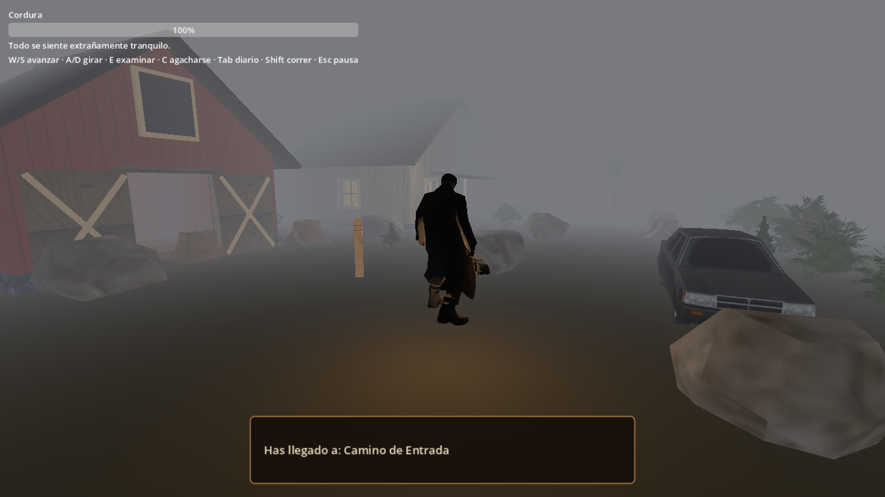
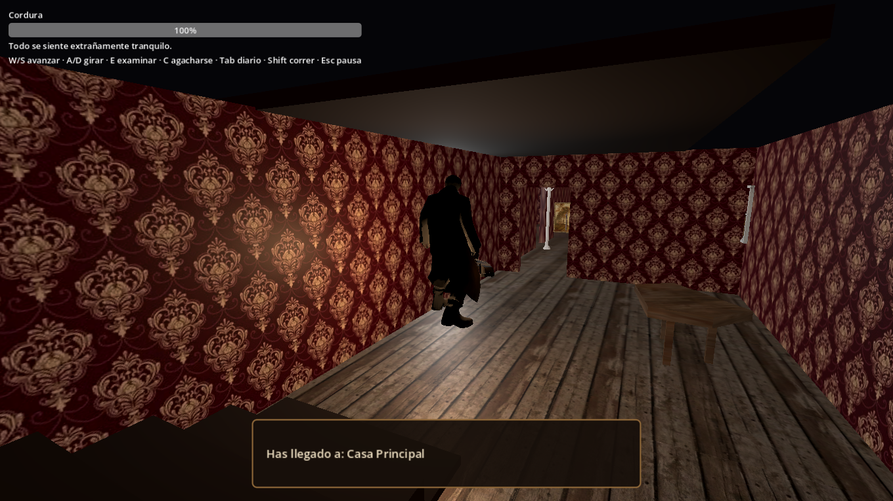
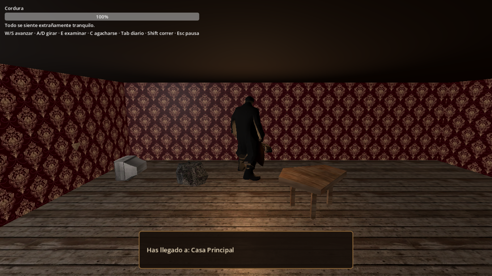
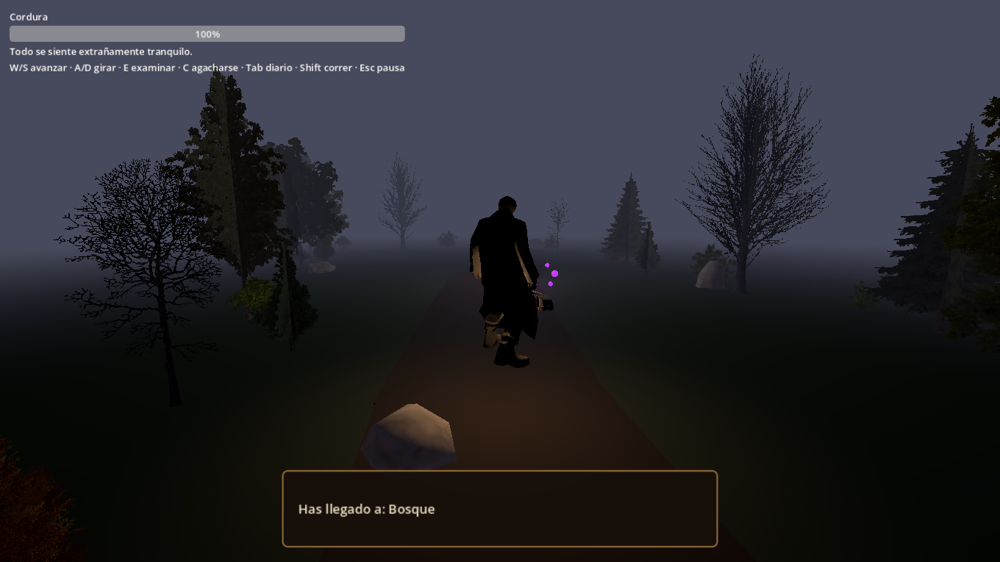
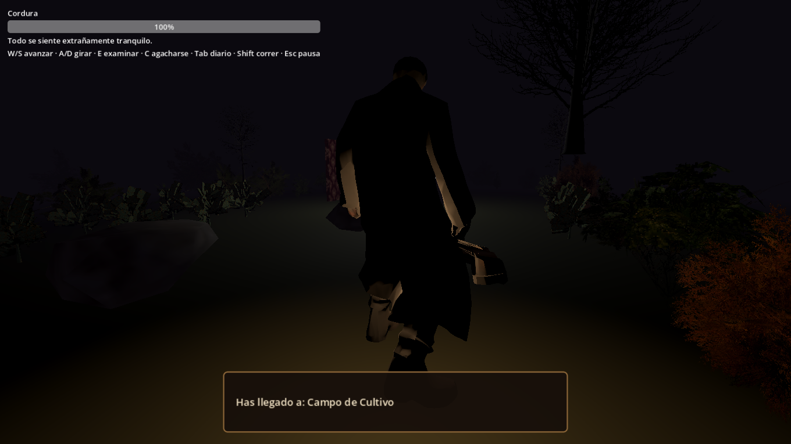
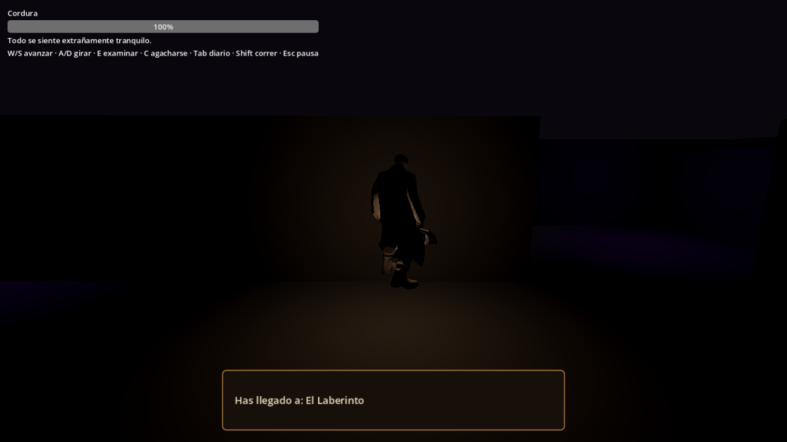
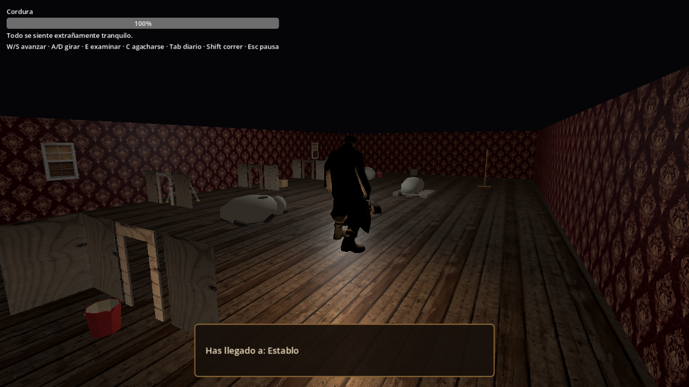
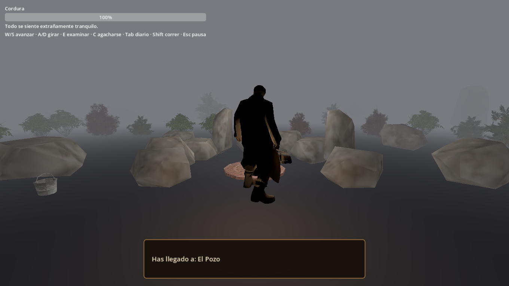
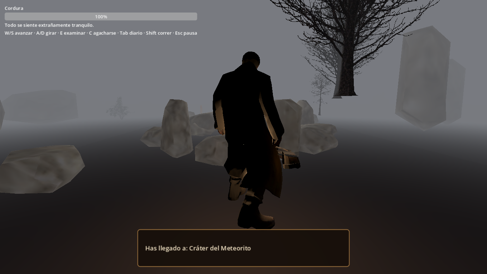
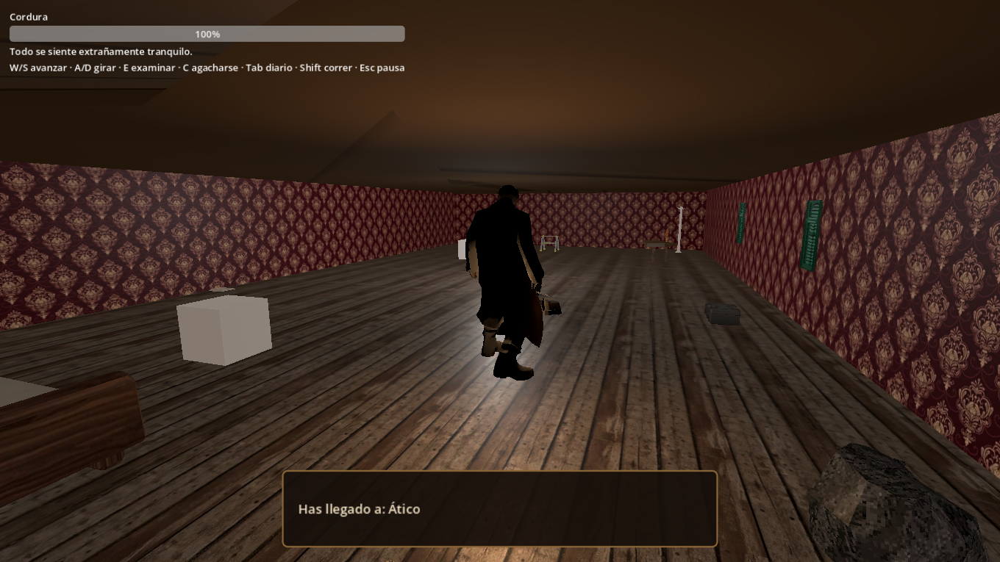

# La Cosecha del Color

Videojuego de terror psicológico inspirado en *El color que cayó del cielo*, de H. P. Lovecraft. La historia y el perseguidor Grapper son una interpretación original del proyecto.

## Estado del proyecto

**Estado de preparación:** beta **0.2.13** (revisión asistida + 9 fixes críticos/altos + 4 magic constants centralizados). Consulta [CHANGELOG.md](CHANGELOG.md) para historial completo; [dist/MANIFIESTO_BETA_0.2.13_MULTIPLATAFORMA.txt](dist/MANIFIESTO_BETA_0.2.13_MULTIPLATAFORMA.txt) identifica las builds.

### Dificultad

Al elegir **Nueva Partida**, selecciona Modo Historia, Normal, Difícil o Lovecraft. Cada perfil modifica caída de cordura, límite de corrupción, intensidad de cámara/terror y presión de Grapper. La dificultad se guarda y se conserva al continuar una partida.

### Cambios y sistemas trabajados

- **Casa principal:** organicé el recorrido en lobby de entrada con fotografías familiares, sala al noroeste con sofá, televisor y lámpara de aceite, cocina al noreste con mesa, refrigerador y fregadero donde está la manivela, y almacén al fondo con estante, libros, radio y cajas. Cerré el vano que permitía cortar camino y añadí una división entre cocina y almacén con paso alineado a la escalera.
- **Ático:** se llega subiendo la escalera; ya no hay una puerta convencional obstruyendo la parte alta. La transición usa una trampilla con animación distinta.
- **Transiciones:** la puerta de las salidas aparece pequeña, se acerca hasta casi la altura de la pantalla y abre/cierra. La trampilla se presenta como un panel cuadrado que se levanta. El autoload persistente controla ambas secuencias y devuelve el control si la escena destino no puede cargarse.
- **Jugador:** la cápsula de colisión se mantiene anclada al suelo al agacharse. La altura del cuerpo cambia sin desplazar el origen, y se comprueba el espacio antes de levantarse. Se conservan las animaciones de caminar agachado y correr a cuatro patas; se filtró el desplazamiento vertical de raíz que provocaba saltos.
- **Bosque:** sendero sinuoso, vegetación, rocas y esporas luminosas para guiar sin revelar todo el entorno.
- **Grapper y laberinto:** amplié el laberinto de 30 × 30 m a 60 × 60 m, con siete tabiques alternados, desvíos y zonas de luz baja. Actualicé la cuadrícula A* del perseguidor al nuevo tamaño y moví las salidas y apariciones a los extremos. Al iniciar su grito, aparece una imagen a pantalla completa con destellos y un grito rasposo de una sola activación por entrada. El WAV se crea con `tools/create_screamer_audio.py`, sin necesitar Audacity.
- **Revisión 0.1.8B:** aceleración planar breve y sprint ajustado por dificultad dentro del laberinto; las apariciones bosque/campo ahora coinciden con sus puertas. Alineé la construcción de paredes horizontales con el grafo de navegación, que antes podía cerrar físicamente un paso marcado como abierto. El Grapper reaparece en una celda libre a seis pasos conectados y su velocidad acompaña el nivel. La revisión completa y sus resultados están en [docs/REVISION_0.1.8B_JUGABILIDAD.md](docs/REVISION_0.1.8B_JUGABILIDAD.md).
- **Audio:** el administrador de música eleva la intensidad según la presión de la persecución. El audio aportado por el usuario está disponible en `audio/persecucion.ogg`.
- **Voces:** preparé un generador local de líneas de voz para ElevenLabs. Consulta `docs/ElevenLabs.md`; las claves se leen desde la variable de entorno y nunca se guardan en el proyecto. La línea de inspector es provisional hasta que el autor cierre la narración.
- **Establo y animales:** el interior queda en penumbra y las vacas son una representación provisional pálida; todavía falta un modelo animal definitivo si se quiere más detalle.

## Controles que muestra el juego

- `W` / `S`: avanzar y retroceder.
- `A` / `D`: girar.
- `E`: examinar o interactuar.
- `C`: agacharse.
- `Shift`: correr.
- `Tab`: diario.
- `Esc`: pausa.

## Capturas de escenas

Las capturas se tomaron en Godot en tiempo de ejecución. `casa_sala.png` muestra un ángulo adicional desde el área interior; la captura principal de la casa conserva el punto de llegada.

**Tráiler promocional:** [ver/descargar `docs/Promo_La_Cosecha.mp4`](docs/Promo_La_Cosecha.mp4). Edición narrada con el archivo de voz de ElevenLabs que aportó el autor, cuatro recorridos de jugabilidad capturados en Godot y un corte de susto con grito distorsionado. Dura exactamente 2036 fotogramas a 24 fps (84,833 s), igual que `audio/persecucion.ogg`. La voz está en [`docs/narration/trailer_elevenlabs.mp3`](docs/narration/trailer_elevenlabs.mp3); el efecto nuevo del Grapper está en [`audio/scream_distorted.wav`](audio/scream_distorted.wav). Las decisiones de tono y montaje están en [`docs/Promo_Referencias.md`](docs/Promo_Referencias.md).

Para regenerar el tráiler con Blender y FFmpeg: `python tools/build_promo_trailer.py`.

| Escena | Captura |
|---|---|
| Camino de entrada |  |
| Casa principal |  |
| Sala de la casa |  |
| Bosque |  |
| Campo de cultivo |  |
| Laberinto |  |
| Establo |  |
| Pozo |  |
| Cráter del meteorito |  |
| Ático |  |

## Pendientes visuales

- Revisar los exteriores grises y con niebla para que camino, campo y cráter se distingan mejor entre sí.
- Probar el laberinto completo en una partida y ajustar la orientación del perseguidor si hace falta.
- Revisar el recorrido completo lobby → sala → cocina → almacén → escalera con una partida; la escena carga, pero hace falta comprobar el ascenso y la trampilla con movimiento real del jugador.
- Revisar el nivel de mezcla de la narración y la pista de persecución en altavoces y audífonos.

## Abrir el proyecto

Abre `project.godot` con Godot 4.7.2. Las escenas jugables están en `scenes3d/` y la lógica asociada en `scripts3d/`.

## Beta multiplataforma 0.2.13

Movimiento tipo tanque (Silent Hill/RE clásico) relativo al personaje — idéntico en teclado, mando y joystick táctil. Cámara anclada al jugador con seguimiento suave. Niebla estilo Silent Hill (FOG_MODE_DEPTH) activa en todas las 9 zonas. Parámetros de juego centralizados en `GameManager.GAMEPLAY` y `ZONE_FOG`. Dificultad HARD/LOVECRAFT con buen final alcanzable (time_limit 1200s). IA perseguidor optimizada (AStarGrid2D reutilizado, callable cache, base run speed cached). Consulta [AGENTS.md](AGENTS.md), [CHANGELOG.md](CHANGELOG.md), [docs/GUIA_LABERINTO_DESARROLLADOR.md](docs/GUIA_LABERINTO_DESARROLLADOR.md), [docs/CONTROLES_MULTIPLATAFORMA.md](docs/CONTROLES_MULTIPLATAFORMA.md) y [dist/MANIFIESTO_BETA_0.2.13_MULTIPLATAFORMA.txt](dist/MANIFIESTO_BETA_0.2.13_MULTIPLATAFORMA.txt).

## Recursos ZIP revisados (27 oct 2026)

Se integró utilería PSX con licencia clara en cocina y bosque. Lista de archivos, atribuciones y notas de licencia: [docs/ASSET_CREDITS.md](docs/ASSET_CREDITS.md).

